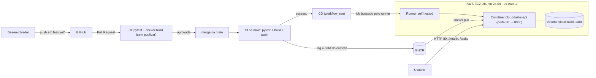
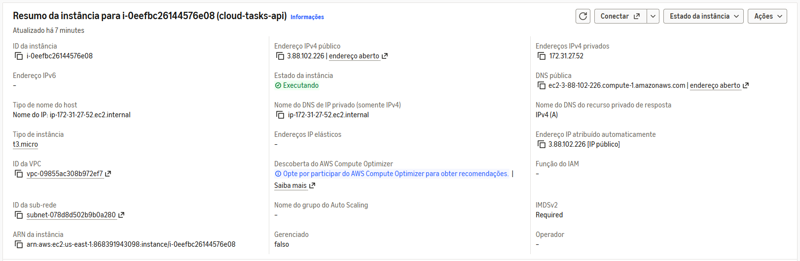
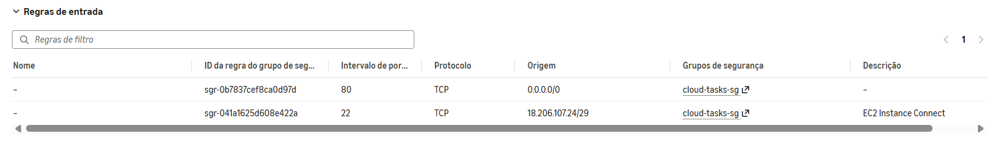
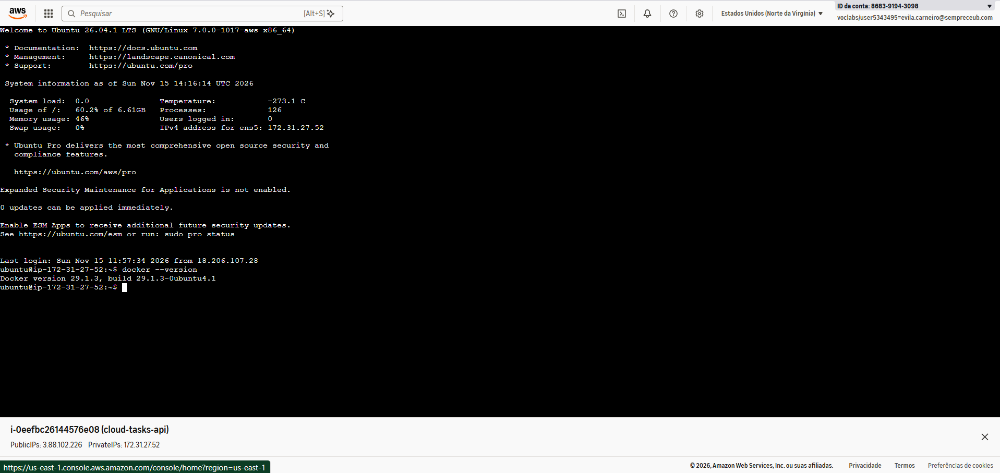

# Relatório — Esteira CI/CD de uma API na AWS

**Disciplina:** Computação em Nuvem
**Aluna:** Évila Maria de Souza Carneiro

## 1. Integrantes e distribuição de tarefas
O trabalho foi realizado individualmente.

## 2. Arquitetura

## 3. Infraestrutura e portas
| Recurso                         | Configuração |
| ------------------------------- | ------------ |
| Região                          | us-east-1 (N. Virgínia) |
| EC2                             | `cloud-tasks-api`, t3.micro, Ubuntu Server 24.04 LTS x86_64, 8 GiB |
| Docker                          | instalado por `scripts/setup-ec2-ubuntu.sh` |
| Security Group `cloud-tasks-sg` | entrada: HTTP 80 de `0.0.0.0/0`; SSH 22 apenas do meu IP e do intervalo do EC2 Instance Connect (`18.206.107.24/29`). Nunca `0.0.0.0/0` no SSH |
| Saída                           | padrão (permite o runner falar com o GitHub e a EC2 baixar a imagem) |

## 4. Pipeline
- **CI** em PR: instala dependências, roda `pytest`, faz build Docker. Não publica imagem nem faz deploy.
- **Publicação:** só em push na `main`, com tag = SHA do commit, no GHCR.
- **CD:** `workflow_run` condicionado ao sucesso da CI em push na `main`; roda no runner self-hosted da EC2, faz `docker pull` da imagem do SHA, recria o contêiner e confere `/health`.

## 5. Segurança e decisão sobre o SSH
O `cd.yml` da base usava runner hospedado do GitHub com SSH, o que exigiria abrir a porta 22 para IPs variáveis. O enunciado proíbe `0.0.0.0/0`. O guia indica runner auto-hospedado como saída, então foi adotada essa alternativa. O runner busca os jobs no GitHub (conexão de saída), logo nenhuma porta de entrada para deploy foi aberta e os segredos `EC2_HOST`, `EC2_SSH_KEY` e `EC2_KNOWN_HOSTS` deixaram de ser necessários. Mitigações: o CD só roda após CI verde em push na `main`; o pacote GHCR é público (sem token na EC2); nenhum segredo no código, logs ou README. Por o repositório ser público, o runner da EC2 poderia ser alvo de workflows de terceiros. Para evitar isso, em Settings → Actions → General foi marcada a opção Require approval for all external contributors, de modo que os workflows de PRs vindos de colaboradores externos só rodam após aprovação manual.

## 6. Evolução funcional
- `DELETE /tasks/<id>`: 204 se removida, 404 se não existe (2 testes).
- Melhoria: filtro `GET /tasks?done=true|false`, com 400 para valor inválido (2 testes).
- Total: 9 testes passando.

## 7. Persistência
1. Criada a tarefa "Teste de persistencia" (`POST /tasks`).
2. `docker rm -f cloud-tasks-api` e `docker ps -a` vazio.
3. Re-run do CD recriou o contêiner com a mesma imagem e o mesmo volume.
4. `curl http://localhost/tasks` voltou com a tarefa (id 1).

## 8. Custos e recursos

A instância foi parada e reiniciada algumas vezes por limitações do ambiente do laboratório (4 inicializações no total). O tempo ligada foi obtido pelas inicializações registradas no próprio sistema (`journalctl --list-boots`) e totalizou aproximadamente **11,5 horas**. Os valores abaixo são **estimativas** com base nos preços de tabela sob demanda (us-east-1).

| Recurso | Uso | Custo estimado |
|---|---|---|
| EC2 t3.micro (Linux) | 11,5 h ligada | 11,5 h × US$ 0,0104/h ≈ US$ 0,12 |
| EBS gp3 8 GiB | cerca de 23 h (da criação à exclusão) | 8 GB × US$ 0,08/GB-mês × 23/730 ≈ US$ 0,02 |
| IPv4 público | 11,5 h associado à instância | 11,5 h × US$ 0,005/h ≈ US$ 0,06 |
| GHCR / GitHub Actions | repositório público, plano gratuito | sem custo |
| **Total estimado** | | **≈ US$ 0,20** |

O consumo real foi debitado do orçamento do laboratório: o painel mostrou US$ 28,60 utilizados de US$ 50,00. O valor do painel acumula todo o uso da conta do laboratório, e não apenas este projeto, por isso é maior que a estimativa acima.

Todos os recursos foram **encerrados** ao fim do trabalho: [prints da instância terminada, volumes e runner removido].

## 9. Dificuldades
- Repositório criado com a pasta do projeto aninhada: o GitHub não achou `.github/workflows` e a CI não rodou. Corrigido recriando o repositório git na pasta interna.
- Deploy sem SSH aberto: resolvido com runner self-hosted na EC2.
- Terminal da AWS: o EC2 Instance Connect exigiu regra de SSH para o intervalo do serviço.
- `docker ps` com `permission denied` logo após a instalação: o grupo `docker` só vale em nova sessão.
- O IP público da instância mudou entre sessões do laboratório; o deploy pelo runner não depende do IP.

## 10. Evidências
| # | Evidência | Link |
|---|---|---|
| 1 | Pull Request com CI verde e revisão | [[link do PR](https://github.com/evimariia/cloud-pipeline-starter/pull/1)] |
| 2 | Run de CI aprovado (PR) | [[link](https://github.com/evimariia/cloud-pipeline-starter/actions/runs/43710879313)] |
| 3 | Run de CD aprovado | [[link](https://github.com/evimariia/cloud-pipeline-starter/actions/runs/43710950985)] |
| 4 | Pacote no GHCR com tag = SHA do commit | [cloud-pipeline-starter](https://github.com/evimariia/cloud-pipeline-starter/pkgs/container/cloud-pipeline-starter) |
